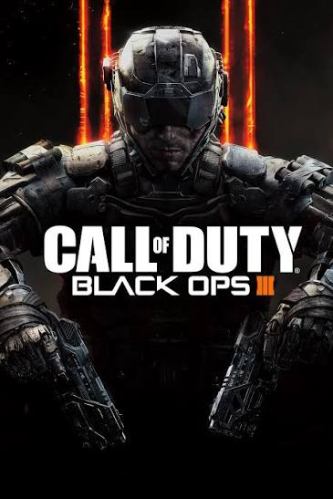

# Call of Duty Black OPS 3 

## Subtitle: One of the best titles of Activision

**This document serves as a *little guide* to my practicing skills on `markdown`**
## Ordered list of the best POV games from Activision 

1. Call of Duty World At War 2008
2. Call of Duty Black Ops 2 - 2009
3. Call of Duty Modern Warfare - 2007
4. Call of Duty Black Ops 3 - 2015
5. Call of Duty Modern Warfare 4 - 2026

'Unordered list of the worst COD titles' 

* Call of Duty Ghosts - 2013
* Call of Duty Infinite Warfare - 2014
* Call of Durt WW2 - 2017

[Check Activision's Website](https://www.activision.com/es)
```bash
# Launch server command
./cod_server -config server.cfg
```
##Game Information Table
|Game title | Release Year | Developer | 
|:---- :---- :----
|Call of Duty: Black Ops 3 | 2015 | Treyarch |
|Call of Duty: Modern Warfare | 2019 | Infinity Ward | 

* [Secondary Document](docs/detalles.md)




